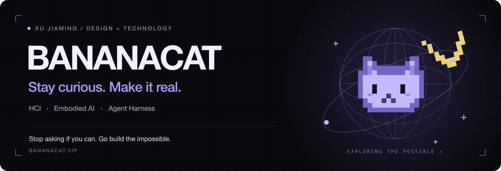

  <a href="https://bananacat.vip"><strong>个人网站 ↗</strong></a>
  &nbsp; · &nbsp;
  <a href="https://bananacat.vip/#projects">设计作品</a>
  &nbsp; · &nbsp;
  <a href="https://bananacat.vip/#mylab">实验室</a>
  &nbsp; · &nbsp;
  <a href="mailto:xuj038904@gmail.com">联系我</a>

### Hi，我是 Xu Jiaming 👋

上海交通大学 **设计学（信息交互）硕士在读**，本科毕业于哈尔滨工业大学数字媒体专业。

我在设计与技术之间探索，关注 **人机交互、具身智能与 Agent Harness**。喜欢从真实问题出发，把想法做成能体验、能验证的作品。

曾在 **字节跳动 / 飞书** 参与 AI 解决方案与商业化实践，做过知识问答、文档自动化、业务系统和 Agent 工作流。

### Exploring / 正在探索

- **Human × AI** — 让人的意图、反馈和判断更好地进入智能系统。
- **Agents & Harness** — 工具调用、上下文组织，以及可验证的 Agent 工作流。
- **Creative technology** — 用生成式 AI、交互叙事和 Web 技术重新表达文化内容。

### Toolkit / 常用工具

  
  
  
  
  
  
  
  
  
  
  
  

`用户研究` `交互设计` `原型设计`

---

  保持好奇，持续创造。 / Stay curious. Keep building. 
  <a href="https://bananacat.vip">bananacat.vip</a> · <a href="mailto:xuj038904@gmail.com">xuj038904@gmail.com</a>

